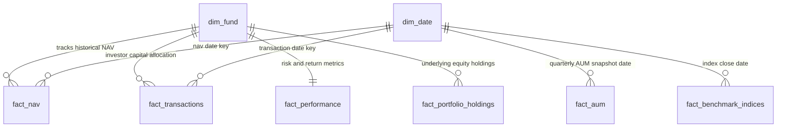

# Bluestock Mutual Fund Analytics Platform — Data Dictionary
**Document Version:** 2.0  
**Date:** 20 November 2026  
**Database Name:** `bluestock_mf.db`  
**Relational Schema:** Star Schema / Normalised Dimensional Model  
**Authors:** SR (Sathwik Ryapaka), AB (Abhiram), AK (Ashmeet Kaur)  

---

## 1. Architecture & Entity-Relationship Overview

---

## 2. Table Specifications & Column Definitions

### 2.1 Table: `dim_fund` (Fund Dimension)
- **Role:** Core dimension table containing master metadata for all tracked mutual fund schemes.
- **Primary Key:** `amfi_code`
- **Source:** AMFI India Scheme Master (`01_fund_master.csv`)

| Column Name | SQLite Type | Constraints | Description & Business Rules | Example Values |
|---|---|---|---|---|
| `amfi_code` | TEXT | PRIMARY KEY, NOT NULL | Unique 6-digit identifier assigned by AMFI to distinguish scheme, plan, and option. | `'119551'`, `'125497'` |
| `fund_house` | TEXT | NOT NULL | Name of the Asset Management Company (AMC) managing the fund. | `'SBI Mutual Fund'`, `'HDFC Mutual Fund'` |
| `scheme_name` | TEXT | NOT NULL | Official full title of the mutual fund scheme. | `'SBI Bluechip Fund - Regular Plan - Growth'` |
| `category` | TEXT | NOT NULL | Broad asset class classification per SEBI guidelines. | `'Equity'`, `'Debt'` |
| `sub_category` | TEXT | NOT NULL | Specific investment mandate / market capitalization tier. | `'Large Cap'`, `'Small Cap'`, `'Liquid'` |
| `plan` | TEXT | NOT NULL | Distribution plan type (`Direct` = low expense, `Regular` = distributor commission). | `'Direct'`, `'Regular'` |
| `launch_date` | TEXT | ISO YYYY-MM-DD | Official inception date of the scheme. | `'2006-02-14'`, `'2013-01-01'` |
| `benchmark` | TEXT | NOT NULL | Official benchmark index for alpha and performance comparison. | `'NIFTY 100 TRI'`, `'BSE 250 SmallCap TRI'` |
| `expense_ratio_pct` | REAL | NOT NULL | Total annual operating fee charged as a percentage of AUM. | `0.66`, `1.54` |
| `exit_load_pct` | REAL | NOT NULL | Penalty percentage charged for early redemption before lock-in. | `1.0`, `0.0` |
| `min_sip_amount` | REAL | CHECK (>= 100) | Minimum monthly investment amount required for SIP (in ₹). | `500.0` |
| `min_lumpsum_amount` | REAL | CHECK (>= 500) | Minimum initial lump-sum purchase amount (in ₹). | `1000.0`, `5000.0` |
| `fund_manager` | TEXT | Nullable | Primary portfolio manager responsible for investment strategy. | `'Sohini Andani'`, `'R. Srinivasan'` |
| `risk_category` | TEXT | SEBI Riskometer | Risk grade evaluated using SEBI standard 6-level riskometer. | `'Low'`, `'Moderate'`, `'High'`, `'Very High'` |
| `sebi_category_code` | TEXT | Internal Code | Standardized SEBI categorization code. | `'EC01'` (Large Cap), `'EC03'` (Small Cap) |

---

### 2.2 Table: `dim_date` (Date Dimension)
- **Role:** Centralized calendar dimension supporting time-series slicing across fiscal periods, quarters, and days.
- **Primary Key:** `date`
- **Source:** Generated Programmatically (2020-01-01 to 2026-12-31)

| Column Name | SQLite Type | Constraints | Description & Business Rules | Example Values |
|---|---|---|---|---|
| `date` | TEXT | PRIMARY KEY | Calendar date in standard ISO 8601 string format (`YYYY-MM-DD`). | `'2024-03-31'` |
| `year` | INTEGER | NOT NULL | Calendar year (4 digits). | `2024`, `2025` |
| `quarter` | INTEGER | CHECK (1-4) | Calendar quarter (1 to 4). | `1`, `2`, `3`, `4` |
| `month` | INTEGER | CHECK (1-12) | Calendar month index (1 to 12). | `3`, `12` |
| `month_name` | TEXT | NOT NULL | Full English name of the calendar month. | `'March'`, `'December'` |
| `day` | INTEGER | CHECK (1-31) | Day of the month. | `1`, `31` |
| `day_of_week` | INTEGER | CHECK (0-6) | Day of the week index (0 = Monday, 6 = Sunday). | `0`, `4`, `6` |
| `day_name` | TEXT | NOT NULL | Full English name of the day. | `'Monday'`, `'Friday'` |
| `is_weekend` | INTEGER | CHECK (0 or 1) | Binary indicator: `1` if Saturday or Sunday, else `0`. | `0`, `1` |
| `fiscal_year` | TEXT | NOT NULL | Indian Financial Year running April 1 to March 31. | `'FY2023-24'`, `'FY2024-25'` |
| `fiscal_quarter` | TEXT | NOT NULL | Indian Financial Year Quarter (`Q1` = Apr-Jun, `Q4` = Jan-Mar). | `'Q1'`, `'Q4'` |

---

### 2.3 Table: `fact_nav` (Daily Net Asset Values Fact)
- **Role:** High-volume time-series fact table tracking daily historical and live NAV records.
- **Primary Key:** `nav_id` (Surrogate), Unique on `(amfi_code, nav_date)`
- **Foreign Keys:** `amfi_code` -> `dim_fund(amfi_code)`, `nav_date` -> `dim_date(date)`
- **Source:** AMFI Public Archives & `mfapi.in` (`02_nav_history.csv`)

| Column Name | SQLite Type | Constraints | Description & Business Rules | Example Values |
|---|---|---|---|---|
| `nav_id` | INTEGER | PRIMARY KEY AUTOINCREMENT | Unique row identifier for database indexing. | `1`, `46000` |
| `amfi_code` | TEXT | FOREIGN KEY, NOT NULL | Foreign key referencing the scheme in `dim_fund`. | `'119551'` |
| `nav_date` | TEXT | FOREIGN KEY, NOT NULL | Date for which the NAV was declared (ISO format). | `'2022-01-03'` |
| `nav` | REAL | CHECK (nav > 0), NOT NULL | Net Asset Value in Indian Rupees (₹) per unit. | `107.3493`, `892.4560` |
| `daily_return` | REAL | Computed | Daily percentage price return calculated as $\frac{NAV_t - NAV_{t-1}}{NAV_{t-1}} \times 100$. | `0.4521`, `-1.2034` |

---

### 2.4 Table: `fact_transactions` (Investor Transactions Fact)
- **Role:** Granular ledger recording individual investor transactions, demographics, and channels.
- **Primary Key:** `transaction_id`
- **Foreign Keys:** `amfi_code` -> `dim_fund(amfi_code)`, `transaction_date` -> `dim_date(date)`
- **Source:** Simulated Transaction Engine (`08_investor_transactions.csv`)

| Column Name | SQLite Type | Constraints | Description & Business Rules | Example Values |
|---|---|---|---|---|
| `transaction_id` | INTEGER | PRIMARY KEY AUTOINCREMENT | Unique identifier for each transaction record. | `1`, `32778` |
| `investor_id` | TEXT | NOT NULL | Unique customer account number (INV000001 - INV005000). | `'INV001249'` |
| `transaction_date`| TEXT | FOREIGN KEY, NOT NULL | Date when transaction was settled (ISO format). | `'2024-05-15'` |
| `amfi_code` | TEXT | FOREIGN KEY, NOT NULL | Scheme code in which the purchase/redemption occurred. | `'120503'` |
| `transaction_type`| TEXT | CHECK (SIP/Lumpsum/Redemption) | Nature of transaction: Systematic Inflow, One-time Inflow, Outflow. | `'SIP'`, `'Lumpsum'`, `'Redemption'` |
| `amount_inr` | REAL | CHECK (amount_inr > 0), NOT NULL | Gross transaction settlement value in Indian Rupees (₹). | `5000.0`, `150000.0` |
| `state` | TEXT | NOT NULL | State of residence of the registered investor. | `'Maharashtra'`, `'Tamil Nadu'` |
| `city` | TEXT | NOT NULL | City location of the registered investor. | `'Mumbai'`, `'Coimbatore'` |
| `city_tier` | TEXT | CHECK (T30 or B30) | AMFI tier categorization: Top 30 Cities vs Beyond Top 30. | `'T30'`, `'B30'` |
| `age_group` | TEXT | Categorical | Demographic age bracket of the investor. | `'26-35'`, `'36-45'` |
| `gender` | TEXT | Categorical | Gender of investor (`Male`, `Female`). | `'Male'`, `'Female'` |
| `annual_income_lakh`| REAL | Positive numeric | Self-declared annual investor income in ₹ Lakhs. | `12.5`, `25.0` |
| `payment_mode` | TEXT | Categorical | Mode used for funds clearance. | `'UPI'`, `'Net Banking'`, `'Mandate'` |
| `kyc_status` | TEXT | CHECK (Verified/Pending) | Verification status under SEBI KYC registration agency. | `'Verified'`, `'Pending'` |

---

### 2.5 Table: `fact_performance` (Fund Analytics & Risk Fact)
- **Role:** Scheme-level quantitative metrics, annualised returns, and risk-adjusted ratios.
- **Primary Key:** `amfi_code`
- **Foreign Key:** `amfi_code` -> `dim_fund(amfi_code)`
- **Source:** Scheme Analytics Engine (`07_scheme_performance.csv`)

| Column Name | SQLite Type | Constraints | Description & Business Rules | Example Values |
|---|---|---|---|---|
| `amfi_code` | TEXT | PRIMARY KEY, NOT NULL | Scheme AMFI code. | `'119551'` |
| `scheme_name` | TEXT | NOT NULL | Official fund name. | `'SBI Bluechip Fund - Regular'` |
| `fund_house` | TEXT | NOT NULL | AMC name. | `'SBI Mutual Fund'` |
| `category` | TEXT | NOT NULL | Asset category. | `'Equity'` |
| `plan` | TEXT | NOT NULL | Regular / Direct plan. | `'Regular'` |
| `return_1yr_pct` | REAL | Numeric | 1-Year absolute trailing return percentage. | `18.45` |
| `return_3yr_pct` | REAL | Numeric | 3-Year annualised compound return (CAGR %). | `14.20` |
| `return_5yr_pct` | REAL | Numeric | 5-Year annualised compound return (CAGR %). | `16.80` |
| `benchmark_3yr_pct`| REAL | Numeric | Benchmark index 3-Year annualised return. | `13.10` |
| `alpha` | REAL | Numeric | Excess return over benchmark: $Return_{3yr} - Benchmark_{3yr}$. | `1.10` |
| `beta` | REAL | Numeric | Sensitivity to market volatility ($1.0$ = benchmark sensitivity). | `0.92` |
| `sharpe_ratio` | REAL | Numeric | Risk-adjusted return: $\frac{R_p - R_f}{\sigma_p}$. | `1.24`, `7.68` |
| `sortino_ratio` | REAL | Numeric | Downside risk-adjusted return penalising downside volatility only. | `1.85` |
| `std_dev_ann_pct` | REAL | Numeric | Annualised standard deviation of daily returns (volatility %). | `14.5`, `0.5` |
| `max_drawdown_pct`| REAL | Numeric | Peak-to-trough worst drop percentage over the period. | `-18.4` |
| `aum_crore` | REAL | Numeric | Scheme total Assets Under Management in ₹ Crore. | `43630.0` |
| `expense_ratio_pct`| REAL | CHECK (0.1 - 2.5) | Annual expense ratio fee percentage. | `1.54` |
| `morningstar_rating`| INTEGER | CHECK (1 - 5) | Simulated performance rating tier (1 to 5 Stars). | `4`, `5` |
| `risk_grade` | TEXT | Categorical | Risk bucket classification. | `'Moderate'`, `'High'` |
| `anomaly_flag` | INTEGER | Binary (0 or 1) | Data quality indicator: `1` if anomalous metric (e.g. extreme Sharpe). | `0`, `1` |
| `anomaly_description`| TEXT | Nullable | Explanatory rationale for flagged data points. | `'High Sharpe due to Low Volatility'` |

---

### 2.6 Table: `fact_aum` (AMC AUM Snapshots Fact)
- **Role:** Historical asset growth and market share tracking for top 10 AMCs across quarters.
- **Primary Key:** `aum_id`
- **Foreign Key:** `date` -> `dim_date(date)`
- **Source:** AMFI Quarterly Disclosures (`03_aum_by_fund_house.csv`)

| Column Name | SQLite Type | Constraints | Description & Business Rules | Example Values |
|---|---|---|---|---|
| `aum_id` | INTEGER | PRIMARY KEY AUTOINCREMENT | Unique record key. | `1`, `90` |
| `date` | TEXT | FOREIGN KEY, NOT NULL | Quarter-end disclosure date (`YYYY-MM-DD`). | `'2025-12-31'` |
| `fund_house` | TEXT | NOT NULL | Fund house name. | `'SBI Mutual Fund'` |
| `aum_lakh_crore` | REAL | NOT NULL | Total AMC AUM in ₹ Lakh Crore. | `12.50` |
| `aum_crore` | REAL | NOT NULL | Total AMC AUM in ₹ Crore ($AUM_{lakh\_cr} \times 100,000$). | `1250000.0` |
| `num_schemes` | INTEGER | NOT NULL | Total active schemes managed by AMC. | `186` |

---

### 2.7 Supporting Tables

#### Table: `fact_monthly_sip`
- **Primary Key:** `month` (`YYYY-MM`)
- **Source:** AMFI Industry SIP Trends (`04_monthly_sip_inflows.csv`)
- **Columns:** `month`, `sip_inflow_crore` (Monthly gross SIP in ₹ Cr), `active_sip_accounts_crore` (Contributing folios), `new_sip_accounts_lakh` (New registrations), `sip_aum_lakh_crore` (Total SIP AUM in ₹ Lakh Cr), `yoy_growth_pct` (Year-over-Year growth percentage).

#### Table: `fact_category_inflows`
- **Primary Key:** `inflow_id`
- **Source:** AMFI Asset Class Data (`05_category_inflows.csv`)
- **Columns:** `inflow_id`, `month`, `category` (Equity, Debt, Hybrid), `net_inflow_crore` (Net capital flow in ₹ Cr).

#### Table: `fact_industry_folios`
- **Primary Key:** `month` (`YYYY-MM`)
- **Source:** AMFI Folio Statistics (`06_industry_folio_count.csv`)
- **Columns:** `month`, `total_folios_crore`, `equity_folios_crore`, `debt_folios_crore`, `hybrid_folios_crore`, `others_folios_crore`.

#### Table: `fact_portfolio_holdings`
- **Primary Key:** `holding_id`
- **Foreign Keys:** `amfi_code` -> `dim_fund(amfi_code)`, `portfolio_date` -> `dim_date(date)`
- **Source:** Fund Monthly Portfolio Disclosures (`09_portfolio_holdings.csv`)
- **Columns:** `holding_id`, `amfi_code`, `stock_symbol` (`RELIANCE`), `stock_name` (`Reliance Industries Ltd`), `sector` (`Energy`, `Banking`), `weight_pct` (% of portfolio), `market_value_cr` (Holding value in ₹ Cr), `current_price_inr` (Stock price), `portfolio_date`.

#### Table: `fact_benchmark_indices`
- **Primary Key:** `benchmark_id`
- **Foreign Key:** `date` -> `dim_date(date)`
- **Source:** NSE/BSE Market Data (`10_benchmark_indices.csv`)
- **Columns:** `benchmark_id`, `date`, `index_name` (`NIFTY50`, `NIFTYMIDCAP150`), `close_value` (Daily closing points).
